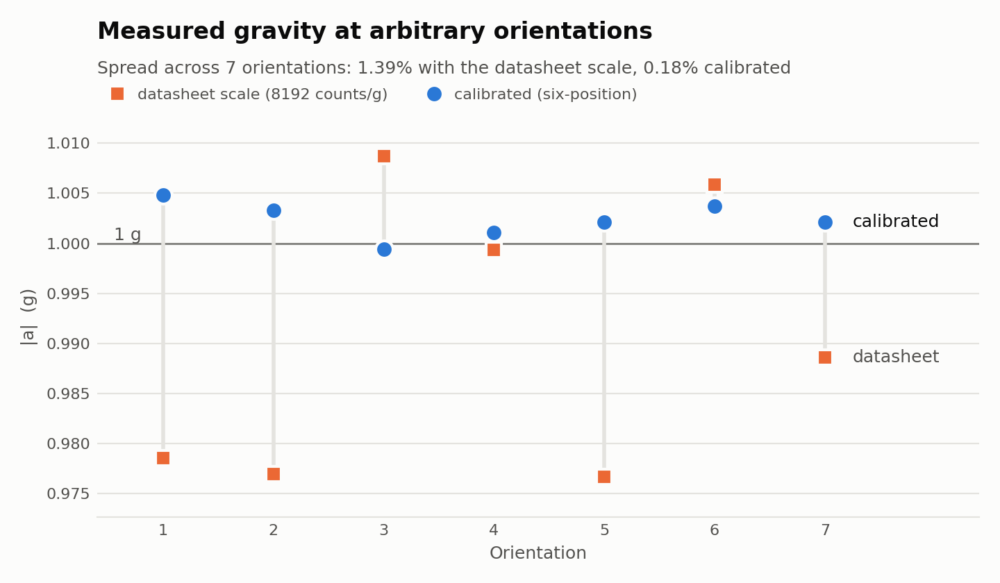
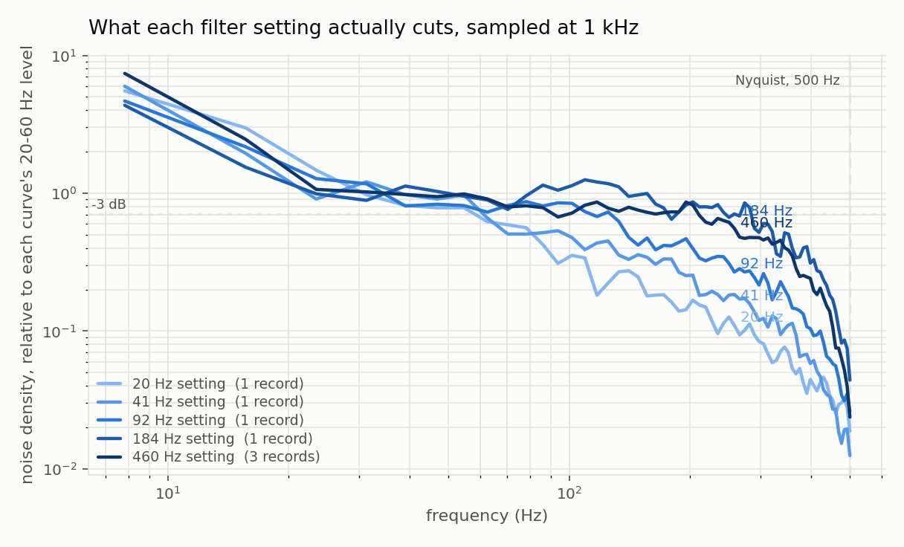

# accelerometer-calibration

Calibrating a low-cost MEMS accelerometer (MPU-6500) against references that do
not depend on any other sensor.

- **Phase 1 — static (done).** Six-position calibration using gravity as the
  reference, checked independently at arbitrary tilts.
- **Phase 2 — dynamic (in progress).** A Scotch-yoke shake table producing
  sinusoidal motion of known amplitude and frequency, to measure frequency
  response. The table is built and running, and the first 3 Hz capture is in.
  The drive is not yet reliable enough for calibration data.

## Why

This project grew out of
[ccs-seismicity-screener](https://github.com/Quinn-777/ccs-seismicity-screener),
a screening framework for induced-seismicity risk at CO₂ storage sites. That
framework was checked against the monitoring records of three real projects,
but it took those records as given. Every one of them came from an instrument
with its own reference and its own error. This repository is an attempt to see,
hands-on, how a raw sensor reading becomes a number that can be trusted.

## Status

- [x] Sensor wired and communicating (I2C address 0x68)
- [x] Fit test printed and iterated
- [x] Calibration cube printed and inspected
- [x] Six-position static calibration
- [x] Independent check at arbitrary orientations
- [x] Sensor identified from WHO_AM_I, and its noise and bandwidth measured
- [x] Shake table printed, assembled and driven at 3 Hz
- [x] Y axis recalibrated in place on the carriage
- [x] First 3 Hz capture
- [ ] Reliable drive (the crank-to-carriage drive slips; see lab notes, 2026-10-23)
- [ ] Crank throw measured to better than ±0.1 mm
- [ ] Frequency sweep, 3–12 Hz

## Phase 1: static calibration against gravity

### Method

At rest, an accelerometer reads 1 g along whichever direction points up. The
sensor is bolted inside a printed cube, and the cube is set on each of its six
faces in turn, so every sensor axis sees +1 g once and −1 g once. For each
axis, the midpoint of the two readings is the zero offset and half their
difference is the scale factor. No angle has to be measured; the method only
needs the cube's faces to be square.

The check is independent of the fit: gravity is 1 g in every orientation, so
after calibration √(ax² + ay² + az²) must come out at 1.000 g at any tilt,
including tilts that played no part in the calibration.

### Result



| Axis | Zero offset | Scale factor | vs datasheet (8192 counts/g) |
|---|---|---|---|
| X | −192 counts (−0.023 g) | 8182 counts/g | −0.12% |
| Y | +57 counts (+0.007 g) | 8217 counts/g | +0.31% |
| Z | +9 counts (+0.001 g) | 8054 counts/g | −1.69% |

Standard error about ±7 counts per value.

At seven orientations not used in the fit:

| | Datasheet scale | Calibrated |
|---|---|---|
| Spread in \|a\| | 1.39% | 0.18% |
| Worst case | 2.3% from 1 g | 0.48% from 1 g |

Only the Z axis departs noticeably from the datasheet value. Because each axis
has its own error, the uncalibrated error changes with orientation (from −2.3%
to +0.9%), so no single correction factor could remove it.

### Supporting checks

- **Out-of-sample readings.** Three Z-axis readings taken before the screws
  were re-tightened were left out of the fit. Their magnitude is 1.3–1.6% low
  with the datasheet scale and 1.001–1.004 g with the calibration.
- **Axis mapping.** Sensor +X points along cube −Y, +Y along cube −X, and +Z
  along cube −Z (the board is mounted chip-side down). Sensor X therefore runs
  along the board's short edge, which matches the silkscreen.
- **Mounting angles.** Each rotation of the board relative to the cube appears
  in two different position pairs, and the two estimates agree:

  | Rotation | Estimate 1 | Estimate 2 |
  |---|---|---|
  | About the line through the mounting holes | 3.10° | 3.32° |
  | In the board plane | 1.07° | 1.12° |
  | About the remaining axis | 0.33° | 0.48° |

  The tilt leaves the offsets unchanged and biases the X and Z scale factors low
  by 0.15–0.19%. That bias predicts calibrated magnitudes slightly above 1 g,
  which the arbitrary-orientation check then showed (mean 1.0024 g). A refit
  that forces |a| = 1 g at every calibration position removes it (mean 1.0013 g).

## Sensor characterisation: noise and bandwidth

An earlier version of this file stated that the accelerometer's digital
low-pass filter was set to 44 Hz. That was wrong, and finding out why it was
wrong turned into a measurement of its own.

The claim came from a line of firmware writing 0x03 to register 0x1A. On the
MPU-6050 that register sets the bandwidth of both the gyroscope and the
accelerometer. On this part it sets the gyroscope's only; the accelerometer's
filter lives in ACCEL_CONFIG2 (0x1D), which the firmware never wrote. Its reset
value is 0x00, so throughout Phase 1 the accelerometer ran at its widest
setting, not at 44 Hz.



Rather than take the datasheet's word for what 0x1D does, the sensor was left
still and captured at all five settings back to back, sampling at 1 kHz. Two
independent measures were taken from the same records:

| Setting | Attenuation at 200–240 Hz | Lag-1 autocorrelation |
|---|---|---|
| 20 Hz | −16.4 dB | 0.97 |
| 41 Hz | −15.0 dB | 0.92 |
| 92 Hz | −9.0 dB | 0.86 |
| 184 Hz | none measurable | 0.54 |
| 460 Hz | −3.4 dB | 0.50–0.85 |

The two columns come from completely different calculations — one from the
spectrum, one from the time series — and they order the five settings the same
way, with no exceptions. A narrower setting cuts more high-frequency content
and makes consecutive samples more alike, which is what a low-pass filter is.
The register does what the datasheet says it does.

Measured noise density, from the settings whose passband covers the reference
band: **about 1.0–1.15 counts/√Hz on X and Y**, roughly twice that on Z. At
±4 g that is about 0.13 mg/√Hz.

Also visible, and relevant to Phase 2: below about 20 Hz the records are
dominated not by the sensor but by the building. Ambient motion reaches roughly
17 counts/√Hz near 5 Hz, more than ten times the sensor's own floor, and it sits
squarely in the 3–12 Hz band the shake table will work in. It is still far below
the drive signal — at 3 Hz the smallest planned amplitude gives about 3,800
counts against roughly 13 counts of ambient in a 1 Hz band — but background
records have to be taken in the same session as loaded ones, not borrowed from
another evening.

**What is not explained.** The measured roll-off is more gradual than a
datasheet filter should be, and each corner sits above its nominal frequency.
Spectral leakage was ruled out by repeating the analysis with a Blackman-Harris
window, which changed nothing. The cause is still open. It does not affect
anything above: the ordering is what establishes that the register controls the
bandwidth, and the Phase 1 results are static measurements that a low-pass
filter passes unchanged.

## Hardware

| Item | Detail |
|---|---|
| Sensor | MPU-6500 on a GY-9250-style breakout, about 25 × 15 mm. WHO_AM_I reads 0x70, which the register map gives as MPU-6500; an MPU-9250 would read 0x71. There is no magnetometer on this board. |
| Controller | Arduino Mega 2560 |
| Calibration cube | 50 mm PLA cube, printed on an Elegoo Neptune 3 Pro; sensor sits chip-side down in a 30 mm deep well |
| Fasteners | M2 × 10 screws; M2 nuts as 1.6 mm spacers under the board. M3 was the original design, but printed holes come out about 0.3 mm under size and would not take an M3 screw. |

Wiring:

| Sensor | Mega 2560 |
|---|---|
| VCC | 5V |
| GND | GND |
| SCL | Pin 21 |
| SDA | Pin 20 |

Sensor settings: ±4 g range (AFS_SEL = 1, nominal 8192 counts/g). Accelerometer
bandwidth is set in ACCEL_CONFIG2 (0x1D) and was left at its reset value for all
of Phase 1; `firmware/burst_log` sets it explicitly and logs it with every
record.

## Reproducing the analysis

```
pip install -r requirements.txt
python analysis/six_position.py      # static calibration and its checks
python analysis/spectrum.py          # noise spectra from data/*.csv
python analysis/capture.py 3         # shake table at 3 Hz, one capture
```

`six_position.py` holds all raw readings inline and writes
`docs/figures/magnitude_check.png`. `spectrum.py` reads the capture files in
`data/` and writes `docs/figures/noise_spectrum.png`.

## Repository layout

```
analysis/six_position.py      calibration, cross-checks, validation, figure
analysis/spectrum.py          noise spectra by filter setting and sample rate
analysis/capture.py           runs shake_log over USB, saves each capture,
                              and warns if the carriage did not move
data/*.csv                    raw captures from burst_log and shake_log
docs/lab-notes.md             dated lab notes, newest first
docs/figures/                 generated figures
firmware/i2c_scan/            confirms the sensor answers at 0x68
firmware/read_raw/            streams raw counts on all three axes
firmware/burst_log/           buffered capture at a fixed rate, with the
                              configuration registers logged alongside
firmware/motor_test/          drives the stepper alone, no sensor
firmware/shake_log/           drives the shake table and samples the sensor
                              in one sketch
hardware/fit_test.*           quick print to check the pocket and holes
hardware/calibration_cube.*   50 mm six-position calibration cube
hardware/yoke_fit_test.*      slot and pin fit coupon for the shake table
hardware/rod_fit_test.*       bushing fit coupon for the 5 mm guide rods
hardware/crank.*              Scotch-yoke crank, one per amplitude
hardware/motor_mount.*        NEMA 17 bracket
hardware/base.*               base plate
hardware/carriage.*           sliding carriage that carries the sensor
hardware/rod_block.*          guide rod end blocks (rod_tie_bar.stl joins them)
hardware/yoke_plate.*         slotted plate that the crank pin drives
hardware/yoke_slot_test.*     slot width coupon for the yoke plate
hardware/land_fit_test.*      rod bore and M2 tap coupon
```

## Known limitations

- Each six-position reading is the mean of six consecutive serial-monitor lines,
  not a long average, so each value carries about ±7 counts of random error.
- Remounting repeatability is about 20–40 counts (0.003–0.005 g). This, not
  the arithmetic, limits offset accuracy.
- The board is tilted about 3.2° in its well because the edge with the pin
  header is unsupported. See the mounting angles above.
- Cube squareness was checked by measuring between opposite faces
  (49.68 mm on all three axes). That confirms size, not the angles between
  faces directly, and no squareness tolerance was verified.
- Static range only: ±1 g. Linearity beyond 1 g is not tested.
- The model is an offset and a scale factor per axis; cross-axis sensitivity
  is not modelled.
- Temperature was not recorded, and MEMS offsets drift with temperature.
- The filter roll-off measured above is shallower than expected and its corners
  sit high; the cause is unresolved.
- One sensor, one mounting.

## Phase 2 (in progress)

A shake table driven by a stepper motor through a Scotch yoke, which turns
rotation into exactly sinusoidal motion. With the crank throw A fixed by the
printed part and the frequency f set by a hardware timer, the peak acceleration
A(2πf)² is known without any reference sensor.

Three cranks give throws of 13, 9 and 6 mm, covering 3–12 Hz with every point
between 0.5 and 3.5 g, and overlapping at 6 and 9 Hz so those frequencies can
be measured at two amplitudes as a cross-check. The upper limit of the range is
set by the ±4 g full scale at the smallest throw the geometry allows (4 g at
12.9 Hz), not by the sensor's bandwidth.

A first-order estimate puts the lowest structural mode near 200 Hz, in the
printed motor bracket rather than the steel guide rods, so structural resonance
is unlikely to set the usable band. The limits expected to matter instead are
that full-scale ceiling and backlash in the yoke slot, whose contribution grows
with frequency. Which dominates will be settled by a harmonic-distortion sweep,
with the acceptance threshold fixed in the lab notes before any data is taken.

Note for the build: on this board the sensor X axis runs along the short edge.

### First results (2026-10-23)

**Y axis, recalibrated on the carriage.** Motion is along sensor Y, so Y was
recalibrated with the sensor already mounted, from five static captures with
the base standing on end, each corrected for its own tilt (1.4–3.9°):
8209 counts/g, offset +95 counts. The five agree to ±2.5 counts. Phase 1 gave
8217 counts/g, so mounting changed the scale by −0.1%.

**First 3 Hz capture** (`data/13mm_3hz_01.csv`, 13 mm crank):

| | Value |
|---|---|
| Commanded frequency | 2.9994 Hz |
| Frequency fitted from the data | 2.9990 Hz |
| Measured peak acceleration (fundamental, Y) | 0.4546 g |
| Spread across the six cycles | ±0.8% |
| Predicted, throw measured as 13.60 ± 0.18 mm | 0.4927 g, ratio 0.923 |
| Predicted, throw re-measured as 13.07 ± 0.10 mm | 0.4735 g, ratio 0.960 |

The frequency is right to 0.01%, so the gap is in the amplitude. The two throw
measurements disagree by more than their errors, and the first was taken with
the carriage pushed outward at each end, which adds any play in the drive to
the stroke. Until the throw is pinned down, the ratio is somewhere between
0.92 and 0.96 and is not a calibration result. The motor was also not yet
bolted to its bracket during this run; it has been since.

## Tools

Arduino IDE, OpenSCAD, ElegooSlicer, Python (NumPy, Matplotlib).

Claude (Anthropic) helped write the firmware, the OpenSCAD models and the
analysis scripts, and reviewed the method and results. The project is a joint
build with a classmate, from Phase 1 on: the classmate assembled the hardware,
the author printed the parts and did the wiring, and troubleshooting was
shared.

## License

MIT
